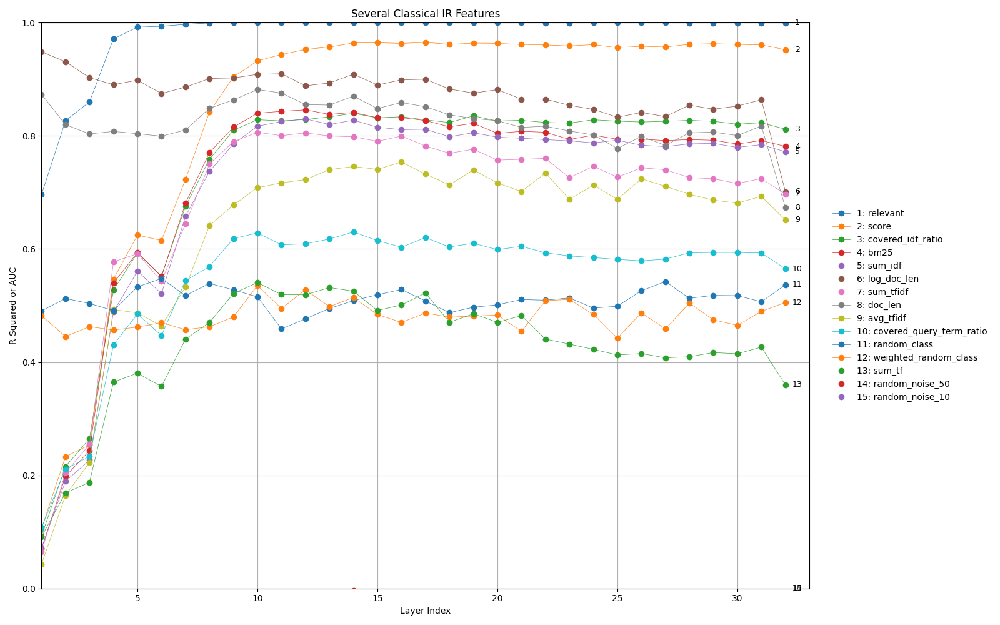

# Probing Rank LLaMa

An exploration of how classical IR feature signals arise in neural reranking models.



We can begin to understand which classical IR features the learned reranking model borrows from by analyzing how different neurons correlate with a given feature.
Specifically, we try to predict the value of that feature from the output of some set of neurons, as this demonstrates those neurons have a correlated signal.

In this particular case, our prediction is some linear combination of the activated values of a layer. A successful prediction indicates similar signals to that feature are being preserved and potentially used by the network in that layer.

Finding the connection between specific neurons and features may eventually help us understand how LLMs make decisions, speed up evaluation time, reduce model sizes, and adjust high level behavior.

## Installation and Reproducibility

Install the relevant libraries: ```pip install -r requirements.txt```.

### Generating Activation Data

First we run the model forward on 3k samples (500 relevant doc-query pairs, 250 non-relevant pairs). Simply run ```generate.py``` inside data/src. This will store the model's activations on these forward passes in a Zarr Store along with the corresponding feature values for each pair in JSON.

```collection_statistics.py``` is used to compute a sufficiently representative word frequency table over the MS Marco corpus.
```compute_features.py``` calculates feature scores (e.g. BM25, Covered IDF Ratio) for each doc-query pair.

### Probing and Analysis

After collecting activation data, we can train per-layer-per-feature linear probes. For continuous features we use a ridge regression and for binary features we use a L2-regularized logistic regression. Regularization here is crucial since 3k samples with 4k input features is an underdetermined system. Probe performance is primarily reported in r^2 for continuous features and AUC for binary ones. Simple extensions to Pearson and Spearman correlation are also discussed below.

All of the analysis scripts are in analysis/src, and the experimental results are stored in their own directories within analysis.

* ```main.py``` simply shuffles the activation data, trains probes on 2.5k samples, and validates on the remaining 500. ```main-results/training``` shows probe performance on the training data, ```main-results/validation``` on the validation data.

* ```cross_class.py``` trains probes separately on only relevant pairs or only non-relevant pairs, then evaluates on the other class. ```cross-class-results/rel_predicting_nrel``` shows probe performance when training on relevant pairs, ```cross-class-results/nrel_predicting_rel``` when trained on non-relevant pairs.

* ```feature_distributions.py``` visualizes the distribution of continuous features within the relevant, non-relevant, and complete distribution.

* ```bootstrap_ci.py``` creates a stratified training set and validation set, then computes 95% confidence intervals. The CI's are generated by stratified bootstrapping that training set (```bootstrap-ci-results/bootstrap-training-data```) and separately doing the same for the validation set (```bootstrap-ci-results/bootstrap-validation-data```). CI's are computed by percentile over 200 samples.

Additionally, the main and cross-class experiment can be easily modified to report Pearson or Spearman correlation, which we show the results of in the analysis result directories. This is a relatively simple change in ```util.py```.