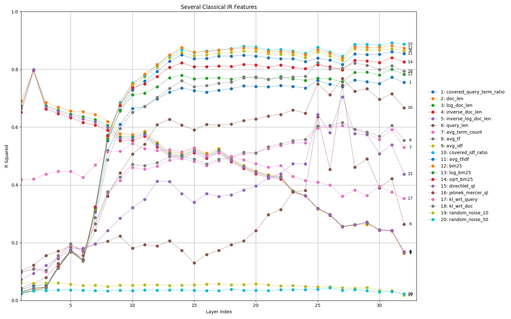

# Probing Rank LLaMa

An exploration of how classical IR feature signals arise in neural reranking models.

We can begin to understand which classical IR features the learned reranking model borrows from by analyzing how different neurons correlate with a given feature.
Specifically, we try to predict the value of that feature from the output of some set of neurons, as this demonstrates those neurons have a correlated signal.

In this particular case, our prediction is some linear combination of the activated values of a layer. A successful prediction indicates similar signals to that feature are being preserved and potentially used by the network in that layer.

Finding the connection between specific neurons and features may eventually help us understand how LLMs make decisions, speed up evaluation time, reduce model sizes, and adjust high level behavior.